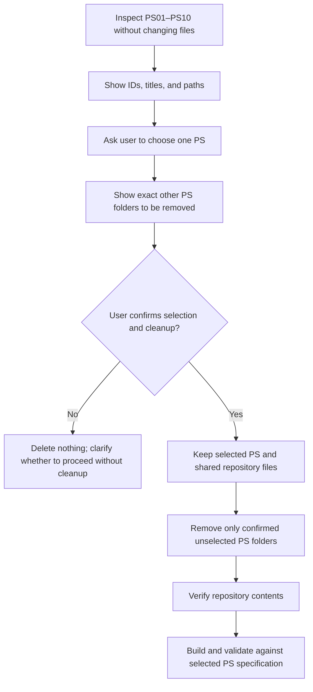

<div align="center">

# Hackathon Problem-Solving Workspace

**One repository. Ten problem statements. One focused solution at a time.**

A clean starting point for choosing a challenge, building against its official specification, and preparing an evaluable submission.

</div>

---

## Welcome

This repository contains ten independent hackathon problem statements in the top-level folders **`PS01` through `PS10`**. Choose one problem statement (PS) to work on. The shared agent instructions are designed to help an AI coding agent understand the selected challenge, respect its evaluation contract, and keep the working checkout focused.

> **Important:** Once you confirm your choice and the disclosed cleanup scope, the agent is instructed to delete the other PS folders from the current checkout. The selected PS folder and files outside the other top-level `PS##` folders are preserved. Make sure you are comfortable with this before confirming.

## Problem statements

| ID | Problem title | Specification |
|---|---|---|
| `PS01` | Explainable Application Privacy and Permission Analyzer | See `PS01.md` |
| `PS02` | Automated Invoice and Payment Reconciliation Dashboard | See `PS02.md` |
| `PS03` | Targeted Model-Repair and Regression-Evaluation Pipeline | See `PS03.md` |
| `PS04` | Offline-First Multimodal AI Assistant for Healthcare | See `PS04.md` |
| `PS05` | Automated Multi-Agent Codebase Vulnerability and Dependency Graph Auditor | See `PS05.md` |
| `PS06` | FAIRSHIFT: Auditable Allocation and Decision-Support System | See `PS06.md` |
| `PS07` | REPROTRACE: Pipeline Observability and Reproducibility Tool | See `PS07.md` |
| `PS08` | AGENTGATE: Security Gateway for AI Actions and Information-Flow Control | See `PS08.md` |
| `PS09` | FORGETGRAPH: Dependency-Aware Deletion Orchestrator for ML Pipelines | See `PS09.md` |
| `PS10` | Open Innovation: Hardware / Embedded Systems / IoT Solution | See `PS10.md` |

Replace the placeholder titles and specification links above with the official details in the problem folders. The authoritative statement inside the selected folder defines the challenge requirements.

## Getting started

1. Open the repository and review the available folders and problem statement titles.
2. Tell your coding agent which PS you want to work on. The agent should list the available PS folders and their exact paths before asking you to choose.
3. Review the agent's confirmation request carefully. It must identify the selected folder and enumerate every other `PS##` folder that will be removed from this checkout.
4. Confirm only if the selected PS and deletion scope are correct. Before that confirmation, the agent must not delete, move, or clean any PS folder.
5. After confirmation and cleanup, read the selected problem's specification and follow its setup, build, test, output, and submission requirements.

If you do not want the other PS folders removed, decline the cleanup and ask to continue with the selected PS while retaining them. The agent should not proceed with destructive cleanup without your explicit consent.

## How selection and cleanup work



The cleanup boundary is limited to the explicitly confirmed, unselected top-level problem folders. Shared code, repository metadata, this README, the top-level `AGENTS.md`, logs, and configuration must remain untouched. Do not use broad wildcard deletion. If you later want to switch to a PS folder that was removed, restore or re-clone it first.

## Repository guide

```text
.
├── AGENTS-generalized.md
├── agent_trace_instructions_generalized.md
├── README.md
├── PS01/
├── PS02/
├── PS03/
├── PS04/
├── PS05/
├── PS06/
├── PS07/
├── PS08/
├── PS09/
└── PS10/
```

Each `PS##/` folder should contain that challenge's participant-facing specification and any allowed starter files or datasets. The actual contents and filenames may differ by problem. Do not assume one PS's input format, output schema, scoring rules, or implementation approach applies to another.

### Agent guidance files

- **`AGENTS-generalized.md`** — primary coding-agent guidance: PS selection and confirmed cleanup, session logging, challenge contract, evaluation safeguards, and cross-platform compatibility. If your coding tool expects a file named `AGENTS.md`, rename or copy this file to that name at the repository root before starting.
- **`agent_trace_instructions_generalized.md`** — guidance for collecting, reviewing, redacting, and packaging agent traces. Follow the selected PS's submission instructions if they specify a different trace artifact or archive layout.

## Build, test, and submit

There is no single build command or output format shared across all ten problems. After choosing a PS, read its official specification and any README or setup notes in that folder. Use the required language, dependencies, input paths, output schema, runtime interface, and submission artifact exactly as stated there.

Before submitting, verify that:

- The solution uses only allowed inputs and resources.
- The required output files exist and match the exact specified schema and coverage.
- The prescribed run and evaluation steps complete successfully.
- The package contains every required artifact and excludes credentials, secrets, and prohibited files.
- Any required agent trace or usage report is included in the requested format.

Use the submission URL stated by the selected challenge. Do not guess a URL or substitute a general contest page for an official submission link.

## Safety and working practices

- **Read the selected specification first.** It is authoritative for problem-specific requirements.
- **Keep secrets out of source control.** Use environment variables or ignored local configuration when the challenge requires credentials.
- **Protect private data.** Review traces and outputs for API keys, tokens, passwords, cookies, private keys, and sensitive personal information before sharing.
- **Keep changes scoped.** Work on the selected PS and shared files only; do not bring assumptions or evaluation labels over from another problem.
- **Retain trace integrity.** Preserve original structured session logs where practical. Redact only sensitive content, and do not include credentials or unrelated application data.

## Contributing or adding problem details

Before using this README as a public project page, replace the placeholder problem titles with the official titles and link each row to the correct participant-facing specification. Add only verified setup and submission information. Keep challenge-specific facts in the relevant `PS##/` folder rather than duplicating them as assumptions in shared instructions.


